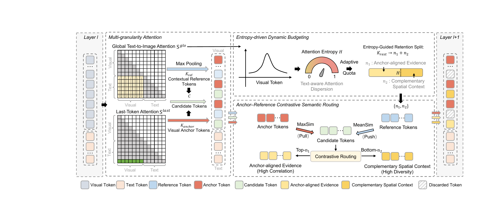

<h1 align="center">COAST</h1>

<p align="center"><b>C</b><b>O</b>ntrastive <b>A</b>daptive <b>S</b>emantic <b>T</b>oken Pruning</p>

<p align="center"><b>Evading Visual Aphasia: Contrastive Adaptive Semantic Token Pruning for Vision-Language Models</b></p>

<p align="center">
  <a href="https://arxiv.org/abs/2605.09429"></a>
  <a href="https://github.com/Liuuuuuyh/COAST"></a>
  <a href="LICENSE"></a>
  <a href="https://python.org"></a>
</p>

<p align="center"><i>COAST treats visual-token compression as adaptive semantic routing: preserve evidence that answers the query while retaining complementary spatial context.</i></p>

## Overview

Vision-language models process hundreds of visual tokens for a single image. A common acceleration strategy ranks these tokens with a scalar attention score and discards the lowest-scoring patches. This assumption is unreliable for compositional reasoning: a token with low attention in an early layer can later become essential for a secondary object, a spatial relation, or a contextual cue. Premature removal can cause **visual aphasia**, where the model loses visual grounding and falls back on language priors.

**COAST** is a training-free, inference-time token pruning framework for vision-language models. It combines query-aware anchor selection, entropy-driven budget allocation, and anchor-reference contrastive routing. The implementation in this repository integrates COAST into the LLaVA Llama backbone without changing the model weights.


## Framework

The framework operates progressively across decoder layers. At each pruning stage, COAST uses the native cross-modal attention already produced by the model:

1. **Multi-granularity attention.** Global text-to-image attention identifies contextual reference tokens through max pooling, while the last-token attention identifies query-specific visual anchors.
2. **Entropy-driven dynamic budgeting.** The normalized entropy of text-aware visual attention measures contextual dispersion. COAST adapts the split between anchor-aligned evidence and complementary spatial context according to this dispersion.
3. **Anchor-reference contrastive routing.** Candidate tokens are scored by their maximum similarity to positive anchors minus their mean similarity to negative/reference anchors. Top-scoring candidates preserve semantic evidence; bottom-scoring candidates preserve complementary context.
4. **Progressive compression.** The retained image tokens are passed to the next decoder layer, so the sequence becomes shorter as inference proceeds.

<p align="center">
  
</p>


## Repository structure

```text
COAST_LLaVA/
├── llava/
│   └── model/language_model/
│       ├── coast_llama.py       # COAST progressive pruning implementation
│       └── llava_llama.py       # LLaVA Llama model integration
├── eval_scripts/                # Evaluation examples
├── pyproject.toml               # Package and dependency configuration
└── README.md
```

## Installation

The code follows the LLaVA 1.5 environment and is tested with Python 3.10, PyTorch 2.1.2, and Transformers 4.37.2.

```bash
git clone https://github.com/Liuuuuuyh/COAST.git
cd COAST
conda create -n coast python=3.10 -y
conda activate coast
# Install a PyTorch build that matches your CUDA version, if needed.
pip install --upgrade pip
pip install -e .
```


## Evaluation

The repository includes evaluation examples under `eval_scripts/`. After installing and configuring `lmms-eval` and its benchmark datasets, run for example:

```bash
CUDA_VISIBLE_DEVICES=0 python -m lmms_eval \
  --num_processes 1 \
  --model llava \
  --model_args pretrained=/path/to/llava-v1.5-7b \
  --tasks mme \
  --batch_size 1 \
  --output_path ./logs/coast/mme
```

For multi-GPU evaluation:

```bash
CUDA_VISIBLE_DEVICES=0,1,2,3 python -m accelerate.commands.launch \
  --num_processes 4 \
  -m lmms_eval \
  --model llava \
  --model_args pretrained=/path/to/llava-v1.5-7b \
  --tasks gqa,pope,mme \
  --batch_size 1 \
  --output_path ./logs/coast/multigpu
```

Benchmark names and dataset preparation follow the installed `lmms-eval` version.

## Citation

If you find COAST useful, please cite our paper and the LLaVA foundation model:

```bibtex
@article{ma2026evading,
  title   = {Evading Visual Aphasia: Contrastive Adaptive Semantic Token Pruning for Vision-Language Models},
  author  = {Ma, Jie and Liu, Yihang and Qiu, Zhike and Ji, Jiayi and Sun, Xiaoshuai},
  journal = {arXiv preprint arXiv:2605.09429},
  year    = {2026},
  doi     = {10.48550/arXiv.2605.09429},
  url     = {https://arxiv.org/abs/2605.09429}
}
```

## Acknowledgements

This project builds on [LLaVA](https://github.com/haotian-liu/LLaVA), [FastV](https://github.com/pkunlp-icler/FastV). We thank the authors and the open-source vision-language community. The repository is released under the Apache License 2.0; see [LICENSE](LICENSE) for details.
